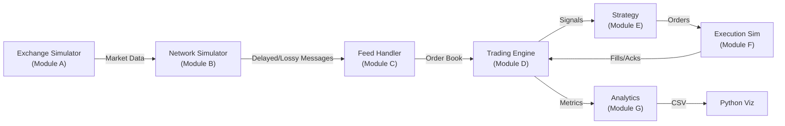

# Network Jitter-Aware Quantitative Trading Simulator — Architecture Plan

## System Overview

## Module Responsibilities

| Module | Responsibility | Key Data Structures |
|--------|---------------|-------------------|
| **A: Exchange** | Generate realistic market data, maintain ground-truth order book, match orders | `OrderBook`, `Order`, `Trade`, `MarketEvent` |
| **B: Network** | Introduce latency/jitter/loss/reorder between exchange and client | `NetworkMessage`, `LatencyModel`, `NetworkConfig` |
| **C: Feed Handler** | Reconstruct order book from potentially lossy/reordered messages | `FeedHandler`, `SequenceTracker`, `GapDetector` |
| **D: Trading Engine** | Concurrent producer-consumer pipeline for market data → strategy → orders | `SPSCQueue`, `MutexQueue`, `TradingEngine` |
| **E: Strategy** | Order book imbalance signal generation with configurable thresholds | `ImbalanceStrategy`, `Signal`, `StrategyConfig` |
| **F: Execution** | Simulate realistic order execution with slippage, latency, adverse selection | `ExecutionSimulator`, `Fill`, `ExecutionReport` |
| **G: Analytics** | Calculate trading/execution/system metrics, export CSV | `PerformanceAnalyzer`, `LatencyTracker` |

## Implementation Phases

1. **Phase 1**: Project setup, CMake, common types, Exchange Simulator with order book
2. **Phase 2**: Order-book imbalance strategy, baseline single-threaded backtest
3. **Phase 3**: Deterministic network simulator (latency, jitter distributions)
4. **Phase 4**: Packet loss, reordering, duplication, recovery
5. **Phase 5**: Concurrent architecture — SPSC ring buffer, mutex queue, trading engine
6. **Phase 6**: OS-level experiments (CPU affinity, busy polling, cache alignment)
7. **Phase 7**: Actual TCP/UDP networking with POSIX sockets
8. **Phase 8**: Execution modeling, transaction costs, adverse selection
9. **Phase 9**: Python visualization, experiment runner, charts
10. **Phase 10**: Documentation, tests, benchmarks, README

## Key Design Decisions

1. **Deterministic first**: All randomness uses seeded `std::mt19937_64`. Network sim is discrete-event before real sockets.
2. **Zero-copy where practical**: Messages passed by move semantics; ring buffer uses placement construction.
3. **Nanosecond timestamps**: All internal timestamps use `std::chrono::steady_clock::time_point` or `uint64_t` nanoseconds.
4. **Configuration-driven**: All parameters in JSON config files, no hardcoded values.
5. **Separation of concerns**: Each module compiles as a static library; `main.cpp` wires them together.
